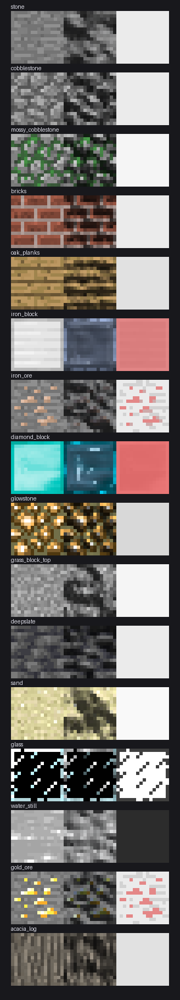

# ProgramArt PBR

给 Minecraft Java 版官方 **Programmer Art**（经典 16×16 老纹理）补上**程序化生成的 labPBR 1.3 物理材质**，覆盖 **1.20 ~ 26.3**，共 **1278 组**法线/高光贴图 + **104 张**自发光贴图。

不是简单把亮度当凹凸。每种方块按名称分类后走独立的物理参数：金属块用**硬编码金属 ID**（铁 230 / 金 231 / 铜 234）并保留自色反射，矿石用「与主色距离」生成遮罩只让矿物颗粒变金属、底层石仍是绝缘体，玻璃/冰这类半透明纹理走硬阈值遮罩而非 alpha 线性缩放（否则平滑度会被一起压没）。



*三联校验图：左=Programmer Art 原色，中=PBR 光照模拟（含环境反射），右=粗糙度（白=粗糙，红偏=金属）。*

## 下载

→ [Releases](https://github.com/XLord-Heliukum/ProgramArt-PBR/releases/latest)

| 文件 | 适用版本 | 内容 |
| --- | --- | --- |
| `ProgramArt-PBR-mc1.20-1.21.8.zip` | 1.20 ~ 1.21.8 | Add-on，仅 `_n`/`_s`/`_e` |
| `ProgramArt-PBR-mc1.21.9-26.3.zip` | 1.21.9 ~ 26.3 | Add-on，仅 `_n`/`_s`/`_e` |
| `ProgramArt-PBR-Full-mc1.20-1.21.8.zip` | 1.20 ~ 1.21.8 | 自带 albedo |
| `ProgramArt-PBR-Full-mc1.21.9-26.3.zip` | 1.21.9 ~ 26.3 | 自带 albedo |

## 安装

1. 安装 **Iris**（或 OptiFine）+ 支持 labPBR 的光影包：Complementary / BSL / Photon / MakeUp UltraFast / Noble。
2. zip 放进 `resourcepacks/` 并在游戏里启用：
   - **Add-on 版**：先启用官方 **Programmer Art**，再把本包叠到它**上面**（列表里更靠上的位置）。
   - **Full 版**：自带 albedo，可独立启用，不需要官方包。
3. 光影设置打开 PBR / 法线 / 视差（POM）。

> 没有装支持 labPBR 的光影包是不会有变化的 —— vanilla 渲染管线不读这些贴图。

### 为什么分成两代两架构

不是偷懒。`pack.mcmeta` 的版本声明在 1.21.9 换了机制：

| 版本范围 | 字段 | 值 |
| --- | --- | --- |
| 1.20 ~ 1.21.8 | `supported_formats` | `[15, 64]` |
| 1.21.9 ~ 26.3 | `min_format` / `max_format` | `[69,0]` ~ `[97,1]` |

1.21.9 起 `supported_formats` 被移除、只认 `min_format`/`max_format`；反过来老版本不认识新字段。**没法用一个 pack.mcmeta 通吃**，所以按版本切两份。26.3 对应 pack_format 97.1，1.21.9 是 69。

## 从源码构建

需要 Python 3.9+ 与本机已安装的 Minecraft Java 版。

```bash
pip install numpy Pillow

# 1) 从本地 Minecraft 拉素材：Programmer Art + 指定版本的原版方块纹理
python3 tools/fetch_sources.py --version 26.3

# 2) 生成 labPBR 贴图（_n / _s / _e）
python3 tools/gen_pbr.py \
  --vanilla work/vanilla/block \
  --pa     work/pa/assets/minecraft/textures/block \
  --out    work/pbr/assets/minecraft/textures/block

# 3) 打包四个版本 + 图标 + 预览图
for m in legacy modern legacy-full modern-full; do python3 tools/build_pack.py $m; done
```

产物落在 `output/`。脚本全部幂等，重复跑只处理变化的部分。

`fetch_sources.py` 会自动处理两处坑：

- **Programmer Art 不在客户端 jar 里。** 它是 Mojang 通过 asset index 单独下发的资源包，key 为 `minecraft/resourcepacks/programmer_art.zip`，文件在 `assets/objects/<hash前2位>/<hash>`。本机没有时会从 Mojang CDN 补下载。
- **Programmer Art 只覆盖 452 个老方块**，26.3 却有 1300 个方块纹理。缺的那 800 多个（deepslate 系、copper 氧化阶段、26.x 新增方块等）用原版纹理作为参考补全 —— Programmer Art 里确实没有它们的对应资源，不给参考就没有法线可生成。
  Add-on 版不包含任何 albedo，实际显示的颜色仍由官方 Programmer Art 决定；`-Full-` 版会把这些补全用的原版纹理一并打包，因此 Full 版里新方块的颜色是原版外观而非经典 Programmer Art —— 这是必然取舍，Programmer Art 没有这些方块的图。

## 贴图通道规范（labPBR 1.3）

`_n.png` — 法线 / AO / 视差

| 通道 | 含义 |
| --- | --- |
| R | 法线 X |
| G | 法线 Y（**DirectX 约定，绿通道朝下**） |
| B | 材质 AO（0 = 全遮蔽，255 = 无遮蔽） |
| A | POM 高度（0 = 25% 深度，255 = 与表面齐平） |

`_s.png` — 高光 / 材质属性

| 通道 | 含义 |
| --- | --- |
| R | perceptual smoothness（= 1 − √roughness） |
| G | metalness（**绝缘体 = 0；金属写 229~237 的硬编码 ID**） |
| B | porosity（0~64）/ subsurface scattering（65~255）共用 |
| A | emissiveness（**255 会被忽略**，故上限 254） |

`_e.png` — 自发光，仅 104 个发光方块产出（glowstone / lava / lantern 等）。

包内含 `assets/minecraft/textures/texture.properties`，声明 `format=lab-pbr/1.3`，光影靠这个宏选择解码路径。

> 生成过程中对着 [shaderlabs 的 labPBR 标准](https://shaderlabs.org/wiki/LabPBR_Material_Standard) 逐通道核对过。第一版实现有 5 处通道语义写错（绿通道朝向、蓝通道是 AO 不是 Z、高度是 0 基准不是 128、porosity 与 SSS 共用 byte 区间、alpha 是自发光不是 SSS），全部重做过。

## 目录结构

```
tools/fetch_sources.py   素材抓取（Programmer Art + 原版纹理）
tools/gen_pbr.py         材质分类 + 法线/高光/自发光生成
tools/build_pack.py      图标、pack.mcmeta、四个 zip
tools/preview.py         生成三联校验图
tools/shadelib.py        预览用的近似 PBR 着色（验证通道是否写对）
output/                  README、预览图、图标 + Release 用的 zip
```

## 许可

**生成脚本（本仓库 `tools/`）采用 MIT License**，见 [LICENSE](LICENSE)。

**Minecraft 与 Programmer Art 纹理的著作权归 Mojang Studios 所有**，不在 MIT 许可范围内。本仓库本身**不包含**任何 Mojang 素材——所有 albedo 均由 `fetch_sources.py` 在构建时从你本机已有的 Minecraft 安装中提取，或临时从 Mojang CDN 下载。Release 附件的 `-Full-` 版本包含 Mojang 素材，仅为方便使用的分发形式，请遵守 Mojang 的使用条款。
